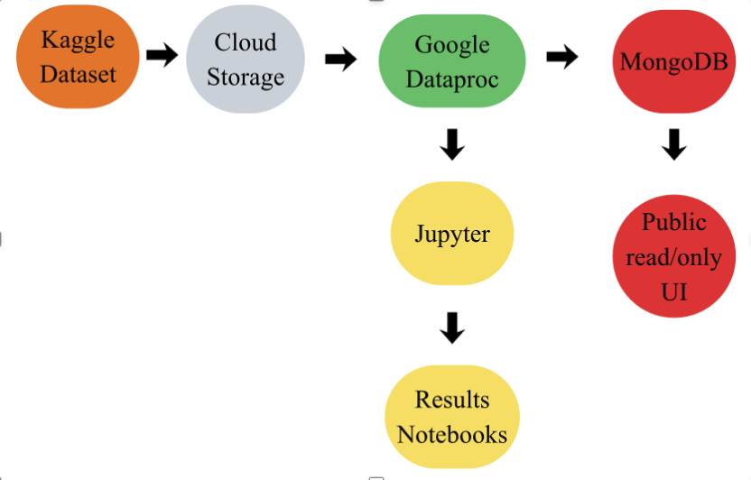

# Distributed Market Analytics

Cloud-native PySpark pipeline for high-frequency volatility forecasting on the
[Optiver Realized Volatility Prediction](https://www.kaggle.com/competitions/optiver-realized-volatility-prediction)
dataset. Built for INFS3208 (Cloud Computing) at UQ.

## Results - no setup required

- **[Live results database](http://34.151.134.53:8081)** (mongo-express) -
  the curated metrics/interpretation each pipeline task wrote (regression,
  clustering, classification, association rules). Public and read-only.
- **Results notebooks** (rendered on GitHub, no download needed):
  [Regression](notebooks/Regression_Results.ipynb) ·
  [Clustering](notebooks/Clustering_Results.ipynb) ·
  [Classification](notebooks/Classification_Results.ipynb) ·
  [Association rules](notebooks/AssociationRules_Results.ipynb) ·
  [EDA](notebooks/EDA.ipynb)

## Cloud deployment

Deployed on GCP: GCS (data lake) → Dataproc (Spark, run as a one-click
Workflow Template) → MongoDB on a GCE VM (results store) → Jupyter via
Dataproc Component Gateway (visualization). Full setup commands in
[GCP_DEPLOYMENT.md](GCP_DEPLOYMENT.md).

